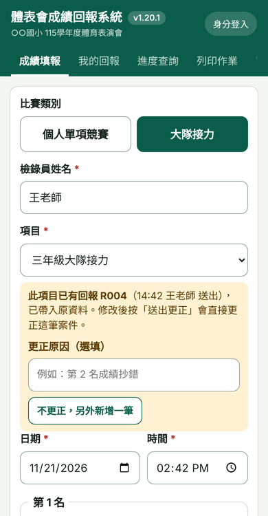
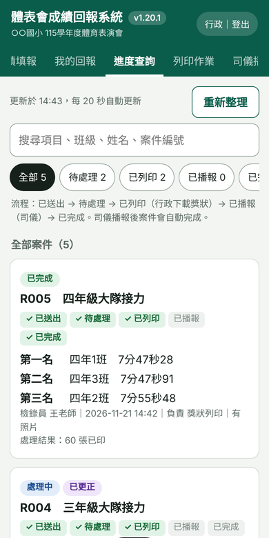
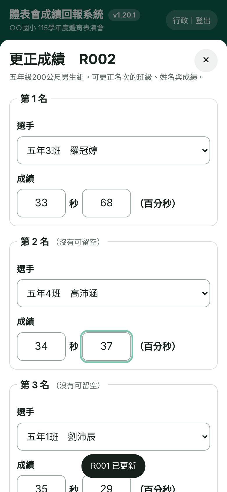

# 體育表演會 成績回報系統

國小體育表演會（運動會）用的成績回報網站，以手機操作為主。檢錄員在比賽現場送出前三名，負責列印獎狀的行政人員與司儀立刻就能看到，並可直接產生獎狀。

以 Google Apps Script 加一份 Google 試算表運作，不需要另外架設主機，也不需要付費服務。

設計者：臺北市福林國小 許士彥 2026.11.21.
目前版本：v1.22.0

## 功能

- **成績填報**：檢錄員一頁填完前三名，可附現場照片，送出後可直接更正。可選擇設定檢錄通行碼。填到一半離開，回來會自動恢復。
- **列印作業**：行政收件、搜尋、更正成績，直接下載 Word 獎狀，或開啟列印頁列印與存成 PDF，也可匯出 Excel 合併列印資料。
- **司儀播報**：大字顯示待播報成績，可自訂播報順序。
- **頒發獎狀**：校長查看可頒發的項目與逾時案件。
- **進度查詢**：每筆成績走到哪一步（已送出、待處理、已列印、已播報、已完成）一目了然。
- **名冊管理**：從 Excel 貼上匯入，或逐筆新增修改。
- **系統設定**：學校名稱、活動名稱、獎狀字號、頒獎日期、獎狀邊界微調、比賽項目。
- **資料管理**：案件資料下載、匯入、清空，刪除前自動備份。

## 畫面

| 成績填報 | 進度查詢 | 更正成績 |
|---|---|---|
|  |  |  |

其餘畫面見 [畫面預覽](畫面預覽) 資料夾。畫面中的姓名皆為虛構。

## 安裝

約 10 到 15 分鐘：

1. 新增一份 Google 試算表，開啟「擴充功能 → Apps Script」。
2. 把 `Code.gs` 與 `Index.html` 的內容貼上。
3. 執行一次 `setup`。
4. 部署為網頁應用程式。

完整步驟與各角色的操作方式，請看 [安裝及使用手冊](安裝及使用手冊.md)。

## 檔案

| 檔案 | 用途 |
|---|---|
| `Code.gs` | 後端程式 |
| `Index.html` | 網頁介面 |
| `安裝及使用手冊.md` | 安裝、設定、操作、常見問題 |
| `範例獎狀/` | 四份範例獎狀，用來試印確認版面 |
| `體表會案件資料_空白範本.csv` | 匯入案件資料用的空白範本 |
| `畫面預覽/` | 各頁面截圖 |

## 個人資料

程式不內建任何名冊，預設值都是中性文字。範例獎狀與截圖裡的姓名皆為虛構，字號為示意。

實際使用時，學生姓名只存在您自己的 Google 試算表裡。部署時若選「所有人」可存取，拿到網址的人都看得到名冊中的姓名，請留意網址的發放對象。

## 獎狀版面

內建的獎狀版面為 A4 直式、標楷體。各校獎狀紙的留白不同，請先用「版面測試獎狀」試印，再到系統設定調整邊界。

## 授權

[MIT License](LICENSE)
